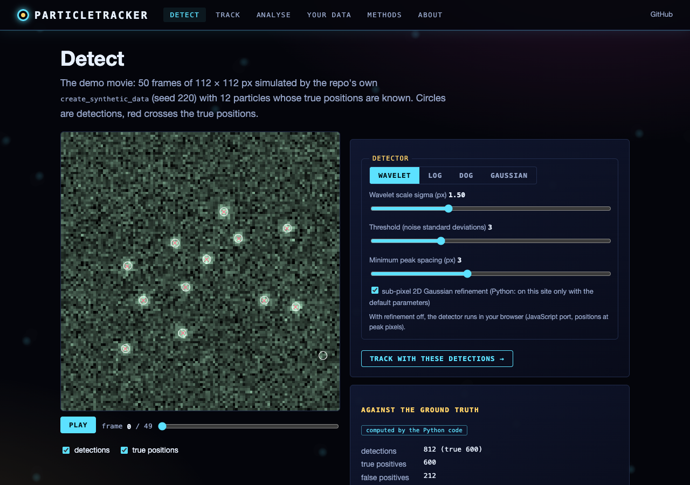
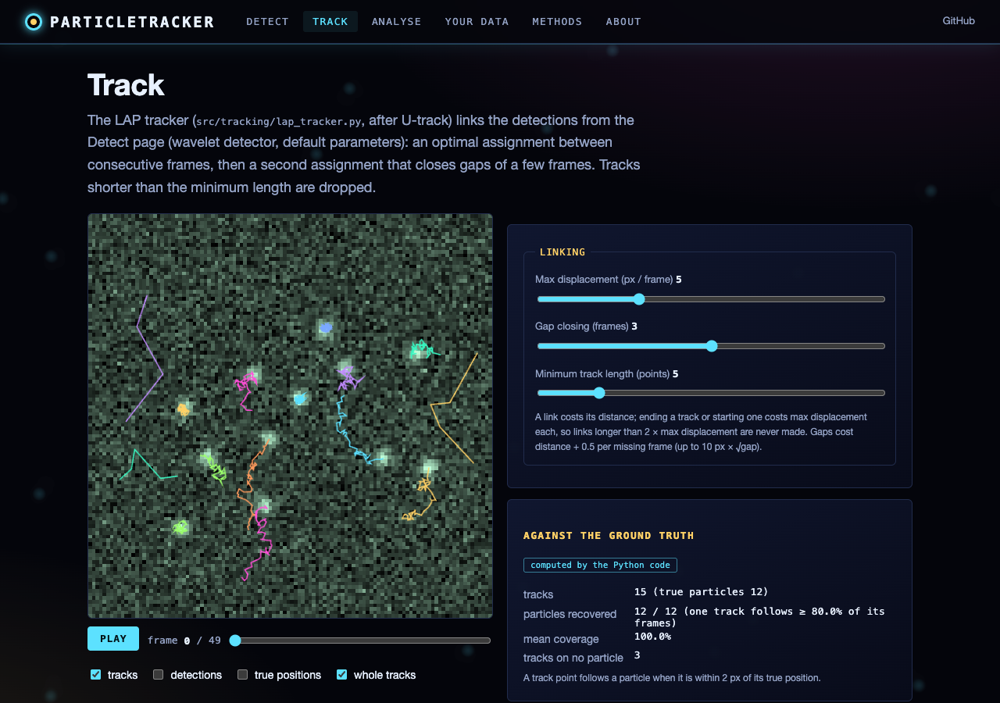
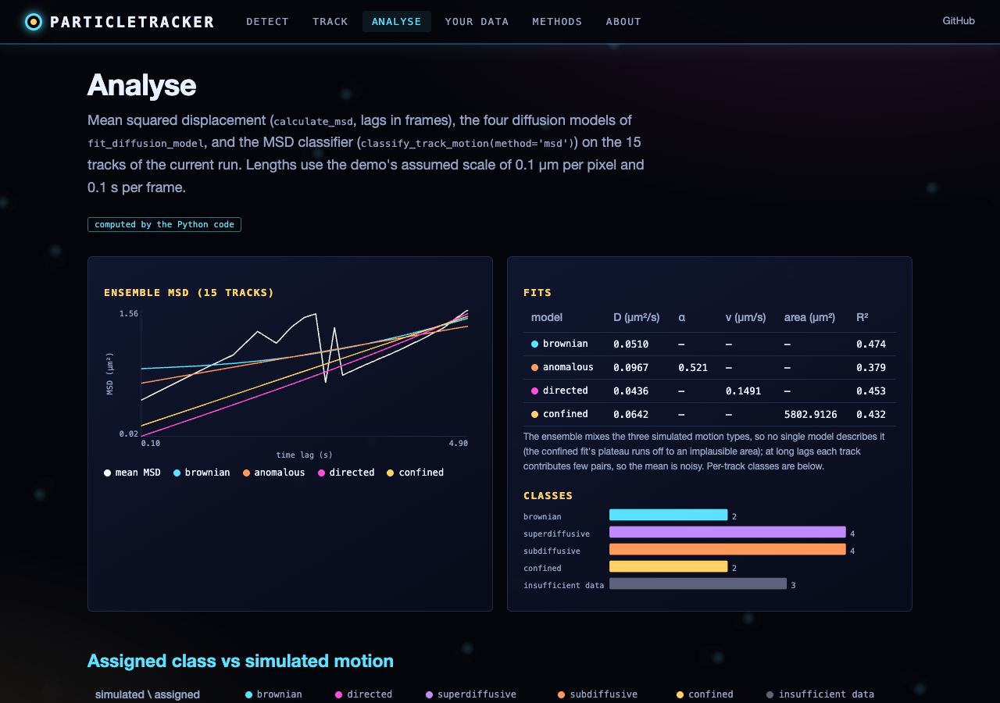
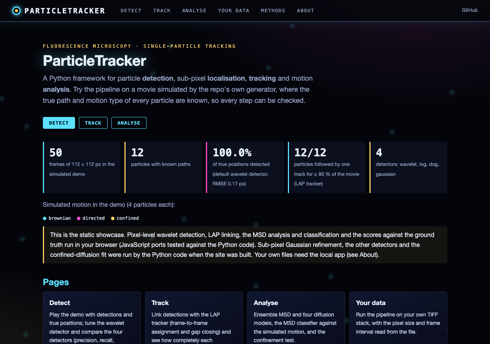

# ParticleTracker: Fluorescence Microscopy Particle Detection and Tracking

## Overview

**ParticleTracker** is a Python framework for particle detection, sub-pixel localization, tracking and motion analysis
in fluorescence microscopy movies (TIRF, widefield). It takes ideas from ThunderSTORM (wavelet detection), U-track (LAP
linking with gap closing) and trackpy, and has a Python API, a PyQt5 desktop GUI and a web interface.

## Features

### Implemented
- **Detection**: wavelet (Mexican hat / LoG, ThunderSTORM-inspired; default), Laplacian of Gaussian, Difference of
  Gaussians and direct Gaussian fitting; sub-pixel localization by 2D Gaussian fitting.
- **Tracking**: Linear Assignment Problem tracker (frame-to-frame assignment + gap closing, after U-track) and a
  nearest-neighbour baseline.
- **Analysis**: mean squared displacement (lags in frames, gaps allowed), Brownian / directed / confined / anomalous
  diffusion fits, velocity, directionality, confinement (Saxton/Simson confinement level) and MSD-based motion
  classification. Results carry their units: pixel size and frame interval are read from ImageJ/OME TIFF metadata.
- **I/O**: TIFF, HDF5 and NumPy input; CSV, HDF5, MATLAB and TrackMate-XML export; project save/load.
- **Synthetic data**: seeded movies with Brownian, directed and confined particles and their ground truth
  (`src/core/simulation.py`).
- **Interfaces**: Python API, PyQt5 GUI (`run_gui.py`), web app (`run_web.py`) and a static demo site.

### Not implemented yet (see ROADMAP.md)
Deep-learning detection or tracking (`create_detector('deep')` raises NotImplementedError), STORM/PALM reconstruction,
drift correction, multiple hypothesis tracking, 3D tracking, the `'ml'` / `'hmm'` classifiers (placeholders that fall
back to the MSD classifier) and batch processing.

## Architecture

```
ParticleTracker/
├── src/
│   ├── core/          # data structures, pipeline (ParticleTracker), simulation
│   ├── detection/     # wavelet, LoG/DoG/Gaussian-fit detectors
│   ├── tracking/      # LAP and nearest-neighbour trackers
│   ├── analysis/      # MSD, diffusion fits, confinement, classification
│   ├── utils/         # I/O and matplotlib visualization
│   ├── gui/           # PyQt5 GUI
│   └── web/           # FastAPI web app + static front end
├── tests/             # pytest suite
├── examples/          # example_workflow.py
├── scripts/           # static-site build, demo movie, JS fixtures, screenshots
└── data/              # example widefield recordings (IC235 crops)
```
See INTERFACE.md for the module map.

## Installation

```bash
git clone https://github.com/gddickinson/ParticleTracker.git
cd ParticleTracker
pip install -r requirements.txt      # or: pip install -e .
```

## Quick Start

### Python API (from the repository root)
```python
from src.core.pipeline import ParticleTracker

tracker = ParticleTracker()
tracker.load_data('path/to/movie.tif')          # pixel size / frame interval from the file, or pass them
detections = tracker.detect(method='wavelet', sigma=1.5, threshold=3.0)
tracks = tracker.track(method='lap', max_displacement=5.0, gap_closing=3)
msd = tracker.analyze_msd(tracks)               # um^2 and s (msd['units'])
diffusion = tracker.fit_diffusion(msd)          # D in um^2/s
classes = tracker.classify_motion(tracks)
tracker.export('results.csv', format='csv')
tracker.visualize(output='tracks.png', show=False)
```
See `examples/example_workflow.py` and QUICKSTART.md.

### GUI Application
```bash
python run_gui.py
```

## Web interface

A local web app and a static GitHub Pages site.

```bash
pip install -r requirements-web.txt
python run_web.py          # http://127.0.0.1:8211
```

Pages: **Detect** (demo movie with detections and true positions, wavelet parameters, four detectors compared),
**Track** (LAP linking parameters, how completely each simulated particle is followed), **Analyse** (ensemble MSD and
fits, MSD classes against the simulated motion, confinement test), **Your data** (the pipeline on your own TIFF stack;
local app only), **Methods** and **About**.

The demo is a 50-frame movie simulated by the repo's own `create_synthetic_data` (seed 220; 4 Brownian, 4 directed,
4 confined particles), so every step is scored against the ground truth. On the static site, pixel-level wavelet
detection, LAP linking, the MSD analysis and classification and the scores run in the browser (JavaScript ports
checked against the Python code by `src/web/static/engines.test.mjs`); sub-pixel Gaussian refinement, the other
detectors and the confined-diffusion fit were run by the Python code when the site was built.

Build the static site with `python scripts/build_static.py` (output in `site/`); `.github/workflows/pages.yml`
publishes it on every push to main. Tests: `python -m pytest -q tests`.

| Detect | Track |
|---|---|
|  |  |
| **Analyse** | **Home** |
|  |  |

## Requirements

- Python ≥ 3.8
- NumPy, SciPy, pandas, scikit-image, tifffile
- PyQt5 and matplotlib (GUI), h5py (HDF5)

## License

MIT License - see LICENSE file for details

## Acknowledgments

This project builds upon the work of:
- ThunderSTORM (Ovesný et al., 2014)
- U-track (Jaqaman et al., 2008; Roudot et al., 2023)
- trackpy (Soft-Matter community)
- Deep learning tracking methods (Spilger et al., 2021)


---
*Built with AI assistance from [Claude (Anthropic)](https://claude.com/).*
